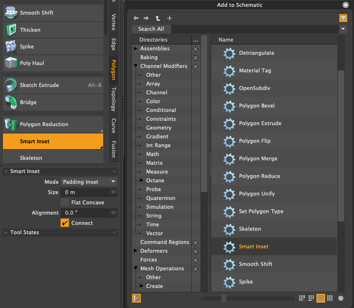
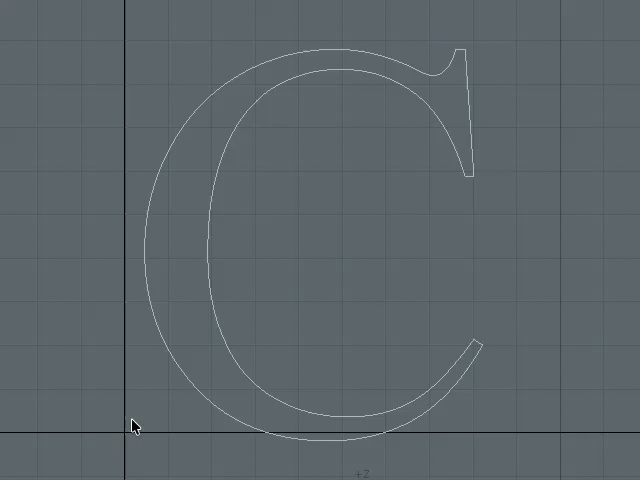
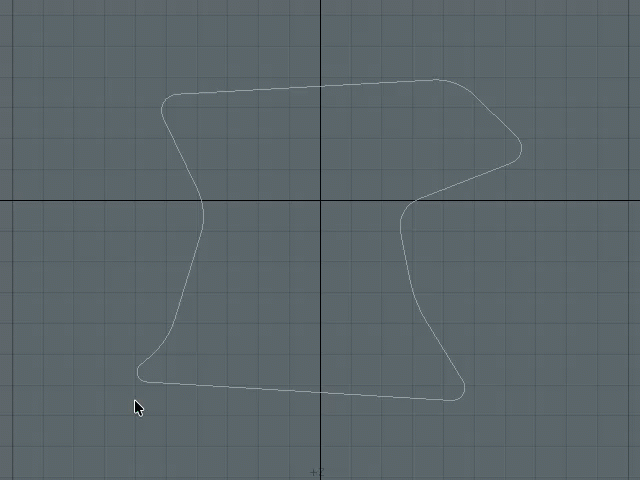
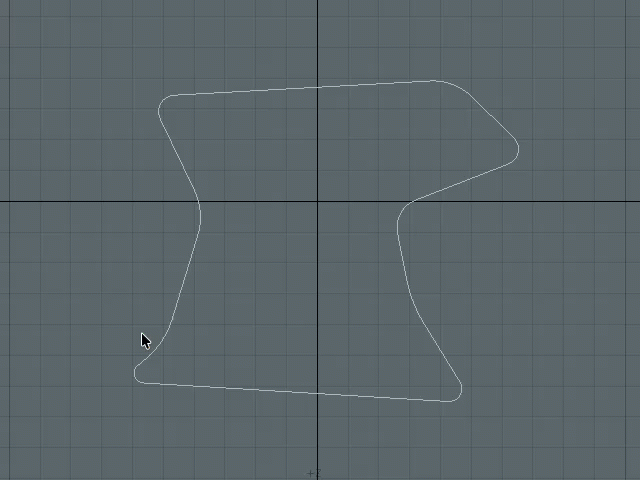

# Smart Inset Kit for Modo

A Modo kit for insetting selected polygons. It provides two modes: a self-intersection prevention algorithm and a parallel-offset subdivision algorithm. These algorithms are based on "Safe Inset" and "Padding Inset," which were created by [Kushiro](https://kushiro.gumroad.com/) as Blender add-ons.


## Installing
- Download lpk from releases. Drag and drop into your Modo viewport. If you're upgrading, delete previous version.

## How to use the plugins
- The tool version of Smart Inset can be launched from "Smart Inset" button on Polygon tab of Modo ToolBar on left.
- The procedural mesh operator version is available on Mesh Operator viewport. That is categorized in Polygon tab.
<div align="left">

</div>

## Direct and Procedural Tools

The direct tool version applies directly to selected polygons via `tool.smartInset`. The procedural tool version adds **Smart Inset** to Polygon Mesh Operations and procedurally evaluates the inset for selected polygons. Edit the mode and parameters in the tool item's channels.

## Mode

- **Safe Inset:** A straight-skeleton-type inset based on internal angle bisectors and 3D collision detection. It automatically detects self-intersections and clamps the movement distance before an intersection occurs.
- **Padding Inset:** An inset based on parallel edge offsets and 2D intersection subdivision. It also supports concave polygons that split into multiple islands.



Safe Inset<br>

Safe Inset<br>


Padding Inset<br>

## Parameters

| Parameter | Type | Description |
| --- | --- | --- |
| `mode` | Selector | Select `safe` or `padding`. |
| `size` | Distance | Inset distance. |
| `threshold` | Numeric | (Safe Inset) Collision-limit detection margin. |
| `merge` | Boolean | (Safe Inset) Automatically merge nearby vertices. |
| `mergeDist` | Distance | (Safe Inset) Vertex merge-distance threshold. |
| `flat` | Boolean | (Padding Inset) Offset concave vertices flat. |
| `align` | Angle | (Padding Inset) Direction for inside/outside determination rays. |
| `connect` | Boolean | (Padding Inset) Connect the outer boundary edges with a side skirt. |


## Dependencies

- LXSDK  
This kit requires Modo SDK (Modo 16.1v8 or later). Download and build LXSDK and set you LXSDK path to LXSDK_PATH in CMakeLists.txt in triagulate.


## License

```
This software is licensed under the GPL-3.0 license.
```